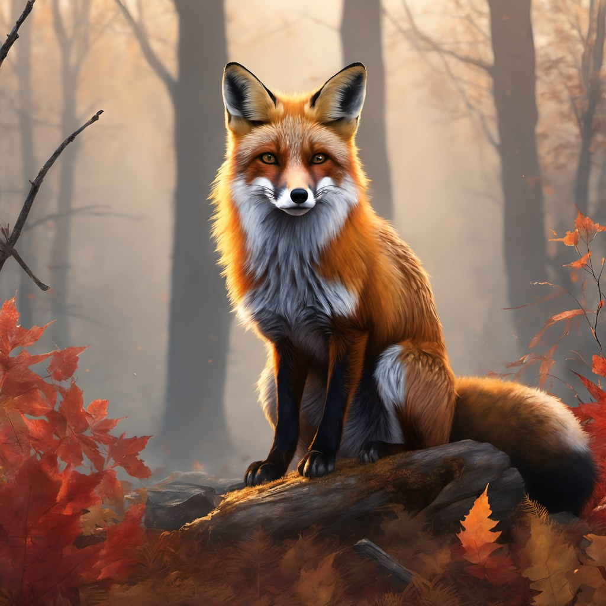
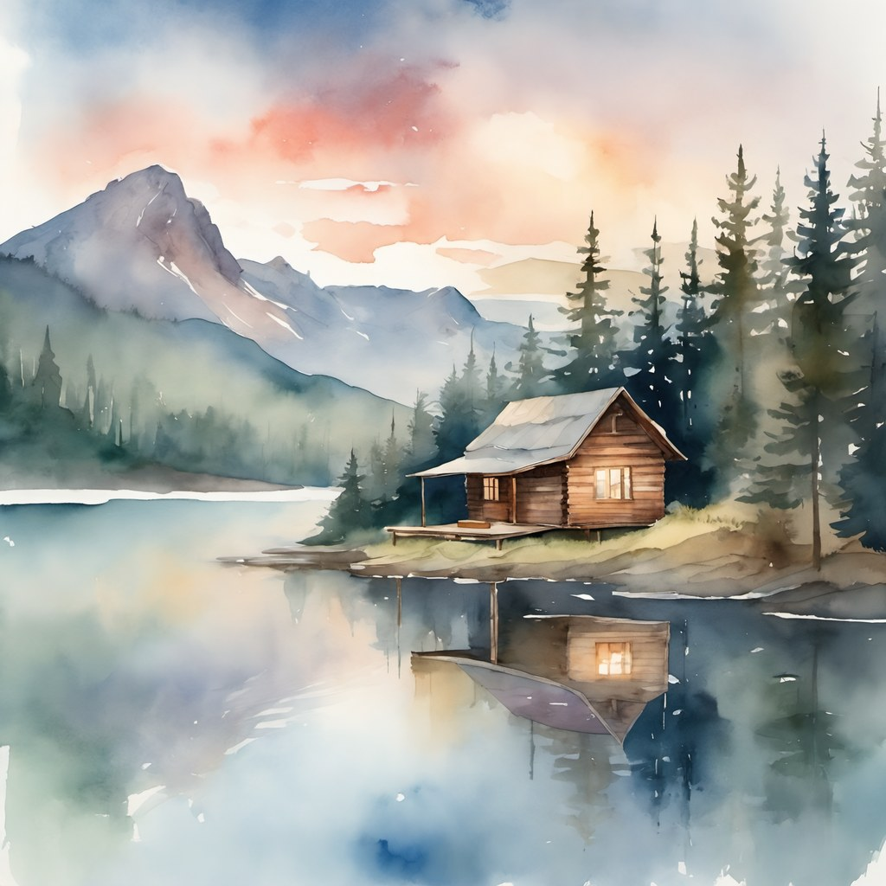
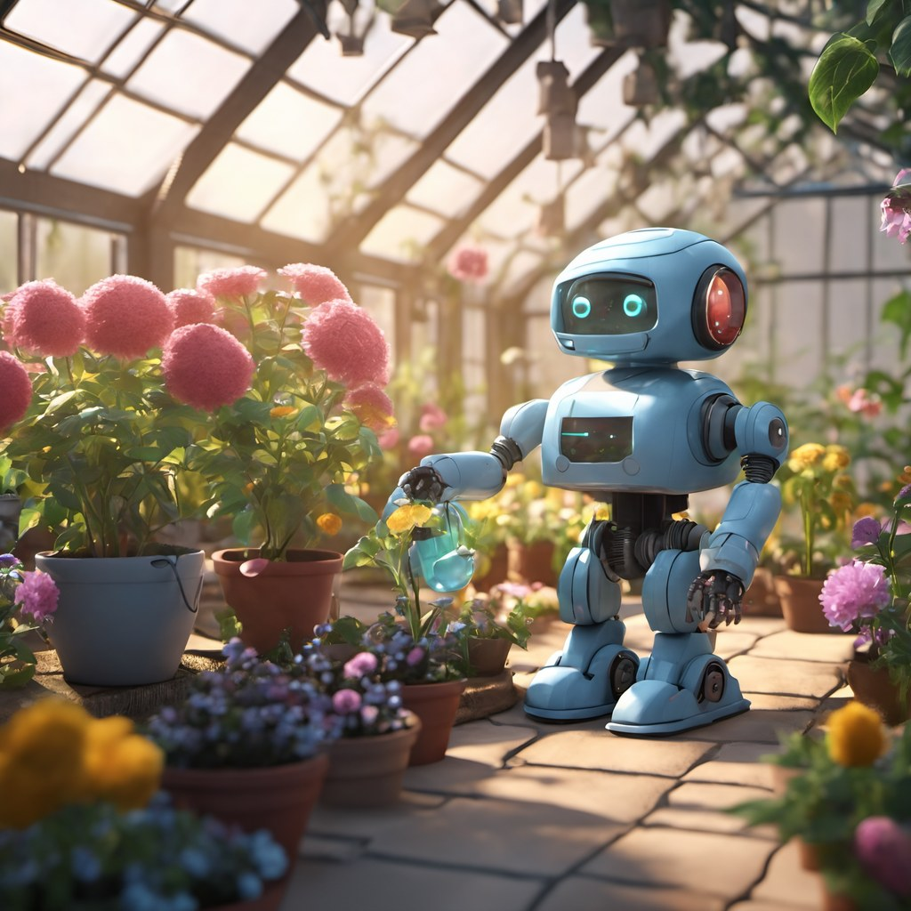
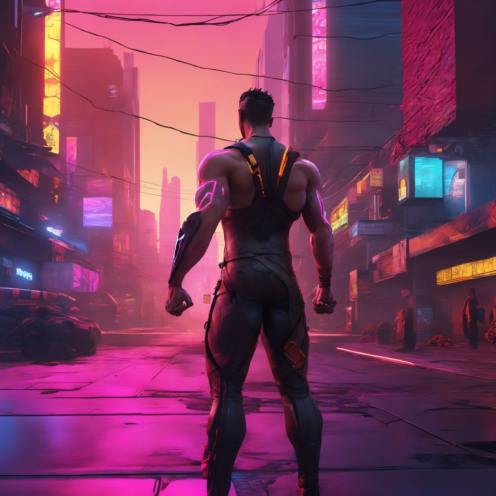
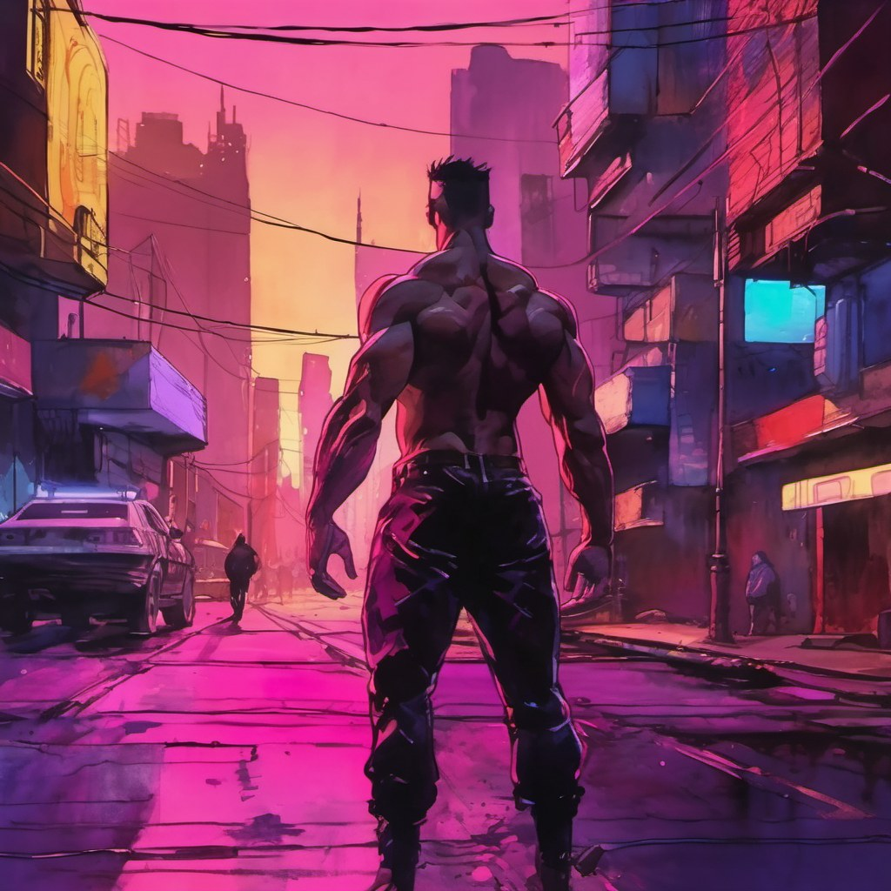
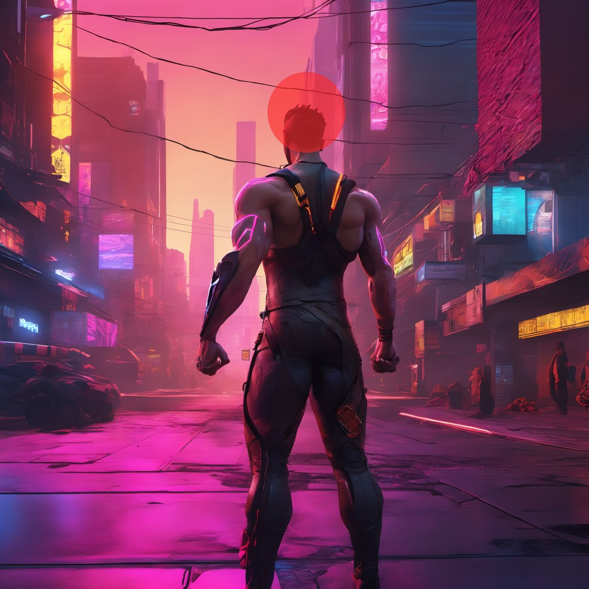
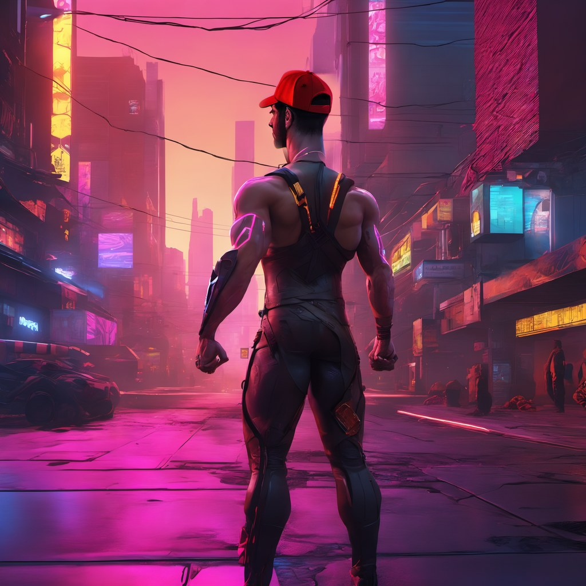
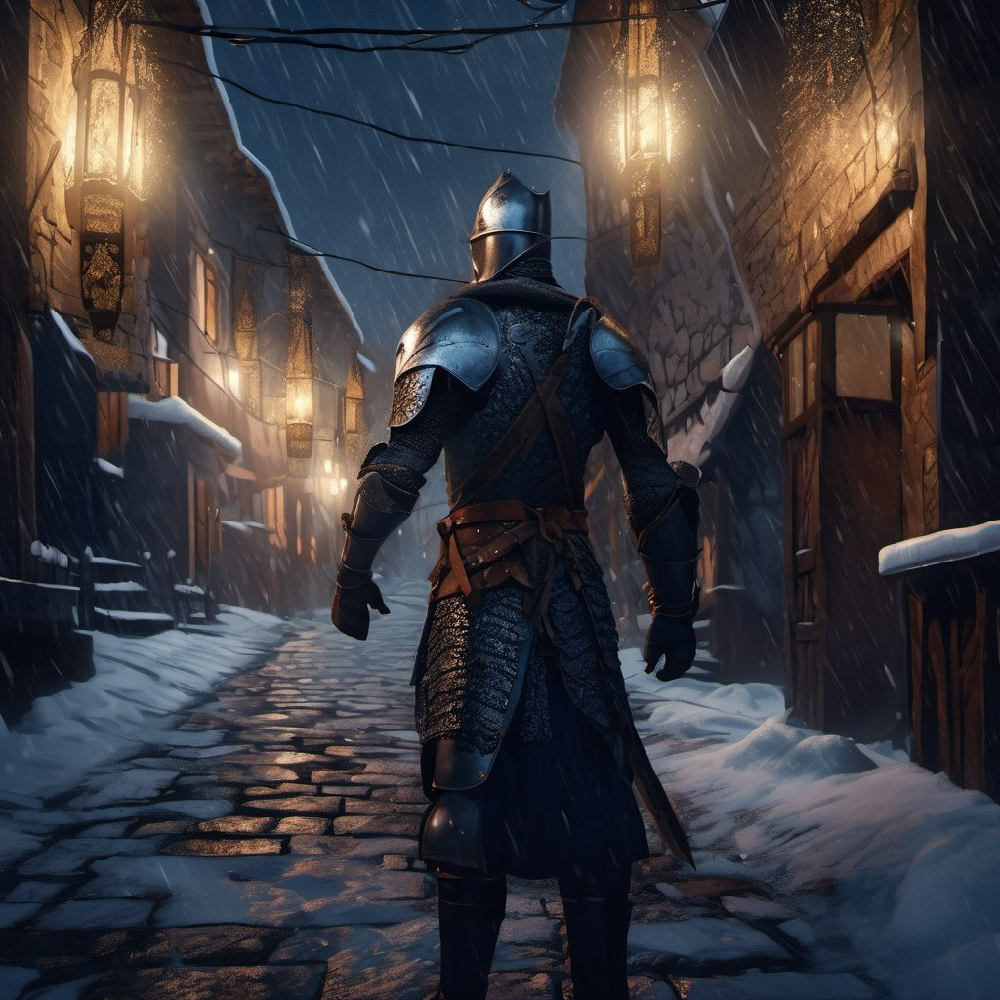
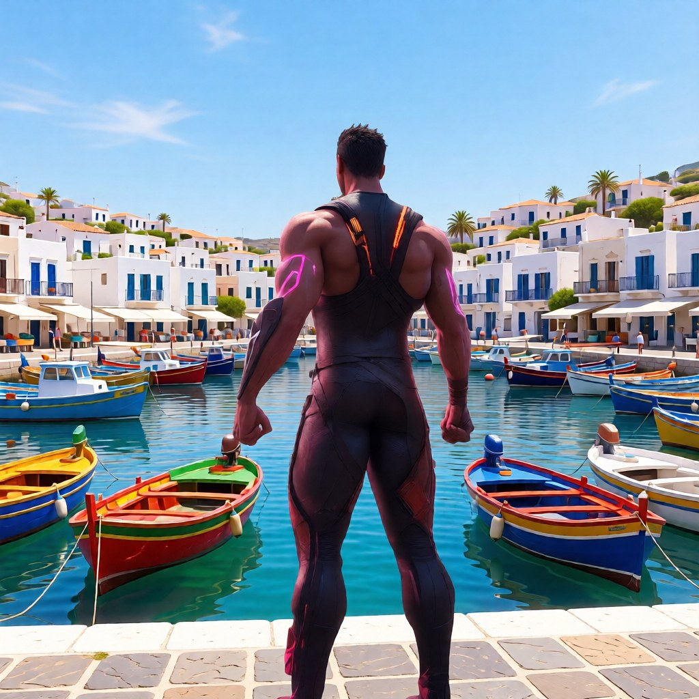

# 3. Utiliser les workflows

Les 5 workflows s'ouvrent depuis l'onglet **Workflows** de la barre latérale de ComfyUI (après
`scripts\5-installer-workflows.ps1`), ou en glissant le fichier `.json` dans la page. Chacun contient un nœud
**Mode d'emploi** en français. Temps mesurés sur la [configuration de référence](01-ma-configuration.md).

## L'interface en 30 secondes

| Action | Comment |
|---|---|
| Ouvrir un workflow | Barre latérale gauche → **Workflows** |
| Lancer la génération | Bouton **Exécuter** (Run) ou **Ctrl+Entrée** |
| Activer / désactiver un nœud ou un groupe | Le sélectionner → **Ctrl+B** (violet = désactivé) |
| Ajouter un nœud | Double-clic dans le vide → taper son nom |
| Relier deux nœuds | Glisser d'une sortie (à droite) vers une entrée (à gauche) de même couleur |
| Voir les résultats | Onglet **Queue**, ou le dossier `ComfyUI\output\` |
| Retrouver les réglages d'une image | Glisser une PNG produite par ComfyUI dans la page : le workflow exact (prompt, seed…) est rechargé |

> ⚠ Dans **Templates**, les modèles `api_*` (Kling, Moonvalley…) envoient la demande à un service cloud **payant**.

---

## Workflow 1 — SDXL texte vers image

1. Décrire l'image dans **Prompt positif**, ce qu'on ne veut pas dans **Prompt négatif**
   (ex. `blurry, low quality, deformed hands, extra fingers, text, watermark`).
2. **Ctrl+Entrée** → aperçu 1024×1024 (≈ 16 s, non enregistré), puis image finale **2048×2048** `output\SDXL_*.png` (≈ 52 s).

Chaîne : base SDXL (pas 0 → 20) → refiner (pas 20 → 25) → aperçu → **RealESRGAN x2** (1024 → 2048) → encodage VAE en
tuiles de 512 → **affinage** 6 pas, denoise 0,3 → décodage en tuiles → enregistrement.

| Réglage (nœud) | Défaut | Effet |
|---|---|---|
| `noise_seed` (*Base*) | aléatoire | **fixed** pour garder une image et ne changer qu'un mot du prompt |
| `steps` | 25 (20 base + 5 refiner) | au-delà de 30, peu de gain |
| `cfg` | 7 | fidélité au prompt ; > 10 image « brûlée », < 4 floue / hors sujet |
| Taille (*Taille de l'image*) | 1024×1024 | rester vers 1 Mpx : 1216×832, 832×1216, 1344×768, 768×1344 |

**Écrire un prompt** (en anglais) : *sujet → action → décor → lumière → style → cadrage*. Ex. :
`a red fox sitting in a snowy forest at dawn, soft golden light, highly detailed, photorealistic, 85mm lens`.
Insister sur un mot : `(golden light:1.3)`. Styles utiles : `photorealistic`, `cinematic still`, `watercolor`,
`digital painting`, `3d render`, `anime style`. SDXL compte mal et invente du faux texte : préférer « no writing ».

**Méthode conseillée** : explorer vite avec l'upscale désactivé (sélectionner le groupe *Upscale x2 + affinage* → Ctrl+B,
≈ 16 s par image), passer le seed en *fixed* quand une image plaît, réactiver l'upscale et relancer.

|  |  |  |
|---|---|---|

---

## Workflow 2 — SDXL image vers image

Garder la composition d'une image (pose, cadrage, palette) et en changer le style ou l'ambiance.

1. *Image de départ* : charger une image (n'importe quelle taille, ramenée à ~1 Mpx en gardant ses proportions).
2. **Prompt positif** : décrire **toute l'image voulue**, pas seulement la modification.
3. Régler **denoise** dans *Transformation* (défaut 0,65), **Ctrl+Entrée** → `output\SDXL_img2img_*.png` (≈ 20 s).
4. Upscale x2 : le groupe bleu *Upscale x2 + affinage* est désactivé par défaut → Ctrl+B pour l'activer.

| denoise | Effet |
|---|---|
| 0,2 – 0,35 | retouche légère, même image |
| 0,4 – 0,55 | touche du nouveau style, l'original domine |
| **0,6 – 0,75** | **vrai changement de style**, pose et cadrage gardés |
| 0,8 – 0,9 | réinterprétation libre |
| 1,0 | l'image de départ est ignorée |

Passer le seed en *fixed* et ne faire varier que `denoise` pour trouver le dosage. `denoise` n'accélère pas le calcul.

| Départ | Résultat (denoise 0,65, prompt « watercolor painting… ») |
|---|---|
|  |  |

---

## Workflow 3 — SDXL retouche d'une zone (inpainting)

Ne régénérer qu'une partie de l'image : un visage, un objet à ajouter ou retirer, une main ratée…

1. *Image de départ* : charger l'image, **clic droit → Open in MaskEditor**, peindre la zone à refaire (un peu plus large
   que l'objet), **Save**. Ou une PNG avec transparence (zone transparente = zone à refaire), comme `entrees\test_inpaint.png`.
2. **Prompt positif** : décrire toute l'image, y compris ce qui doit apparaître dans la zone.
3. **Ctrl+Entrée** → `output\SDXL_inpaint_*.png` (≈ 19 s). Hors du masque, l'image est conservée au pixel près.

| Réglage (nœud) | Défaut | Effet |
|---|---|---|
| `denoise` (*Génération dans la zone*) | 0,9 | 1,0 ignore le contenu de la zone ; 0,5–0,7 garde formes et couleurs |
| `expand` (*Marge du masque*) | 16 px | à augmenter si l'objet est coupé |
| `blur_radius` (*Adoucissement du bord*) | 15 | à augmenter si la jointure se voit |

Chaîne : masque agrandi puis flouté → `DifferentialDiffusion` → `InpaintModelConditioning` → KSampler →
`ImageCompositeMasked` (recollage dans l'original). Marche avec le modèle SDXL normal, sans modèle d'inpainting dédié.

| Masque (en rouge) | Résultat (« …wearing a red baseball cap… ») |
|---|---|
|  |  |

---

## Workflow 4 — SDXL guidé par les contours (ControlNet)

Garder la **composition exacte** (silhouettes, perspective, jusqu'aux câbles électriques) et changer sujet, décor, époque
ou style. Marche aussi à partir d'un croquis.

1. *Image de départ* : charger l'image ; **Prompt positif** : décrire la **nouvelle** image.
2. **Ctrl+Entrée** → `output\SDXL_controlnet_*.png` (≈ 25 s). Les contours détectés s'affichent dans *Contours (aperçu)*.

| Réglage (nœud) | Défaut | Effet |
|---|---|---|
| `strength` (*Application ControlNet*) | 0,7 | 0,4–0,6 plus libre ; 0,8–1,0 très strict |
| `end_percent` | 0,8 | le guidage s'arrête à 80 % des pas pour laisser finir les détails |
| `denoise` (*Génération*) | 1,0 | 0,75 garde un peu de la lumière d'origine ; 0,5–0,6 garde les couleurs |
| Seuils (*Détection des contours*) | 0,4 / 0,8 | plus bas = plus de détails gardés |

Modèle : **ControlNet Union ProMax** pour SDXL (xinsir). Il sait aussi suivre profondeur ou pose, mais ces guidages
demandent un détecteur absent de ComfyUI d'origine (nœud tiers `comfyui_controlnet_aux`, volontairement non installé).

| Départ | Résultat (« a medieval knight in full plate armor… snowy mountain village at night ») |
|---|---|
|  |  |

---

## Workflow 5 — Qwen édition par instruction

**Qwen-Image-Edit-2511** : on décrit la modification en une phrase, avec jusqu'à 3 images (« remplace le décor par une
plage », « mets la personne de l'image 2 dans la voiture de l'image 1 », « change la couleur de la voiture »…). Les visages
et les détails sont bien conservés.

1. *Image 1* : l'image à modifier ; **la sortie garde son cadrage** (ramenée à ~1 Mpx).
2. *Image 2* / *Image 3* (facultatives, violettes = désactivées) : sélectionner → **Ctrl+B** → charger l'image.
3. **Instruction** en anglais, en désignant les images (`image 1`, `image 2`…) et en précisant **ce qui doit rester
   identique** (« keep the faces exactly identical »).
4. **Ctrl+Entrée** → `output\QwenEdit_*.png` : ≈ 2,5 min (≈ 4 min à froid), ≈ 6,5 min avec 2 images.

| Mode | Réglages | Remarque |
|---|---|---|
| Rapide (défaut) | *LoRA Lightning* actif, KSampler **4 pas, CFG 1** | déjà très bon |
| Qualité max | *LoRA Lightning* désactivé (Ctrl+B), KSampler **40 pas, CFG 4** | ≈ 10× plus long |

Le modèle (20 Go) dépasse les 16 Go de la carte : une partie tourne depuis la RAM. Fermer les applications gourmandes.

| Départ | Résultat (« Replace the cyberpunk city with a sunny Mediterranean fishing harbour… Keep the man… identical ») |
|---|---|
|  |  |

> Limite : ComfyUI 0.3.68 est antérieur à la 2511 ; le modèle est utilisé converti (voir [02-installation.md](02-installation.md#4-télécharger-les-modèles))
> et son réglage propre `index_timestep_zero` n'est pas pris en charge. La fidélité pourrait encore progresser avec un ComfyUI plus récent.

---

## Pistes pour aller plus loin

- **Profondeur / pose** avec le même ControlNet Union : nœud tiers `comfyui_controlnet_aux` (Depth Anything, OpenPose…).
- **Upscale plus rapide** : affinage en tuiles (nœud tiers *Ultimate SD Upscale*) ou upscale x1,5.
- **Mettre à jour ComfyUI** pour utiliser Qwen-Image-Edit-2511 sans conversion — en sachant qu'une mise à jour ou une
  réparation par l'AMD Install Manager peut **écraser les correctifs** : relancer alors `scripts\installer.ps1`.
